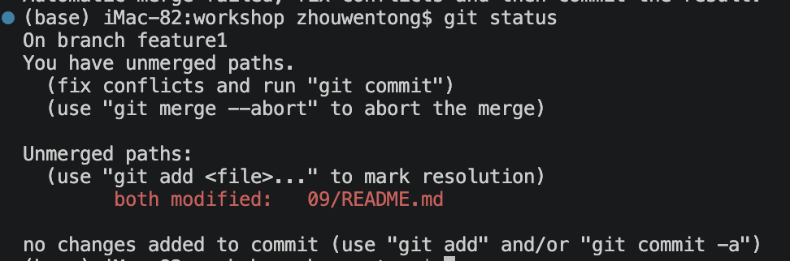
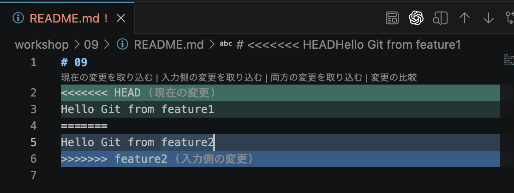

# 09



## 解消後
Hello Git from feature1&2

```bash
git log --graph --oneline
*   c5ea8be (HEAD -> feature1) resolve merge conflict
|\  
| * 54965d9 (feature2) Update file on feature2
* | af4f158 Update from feature1
|/  
